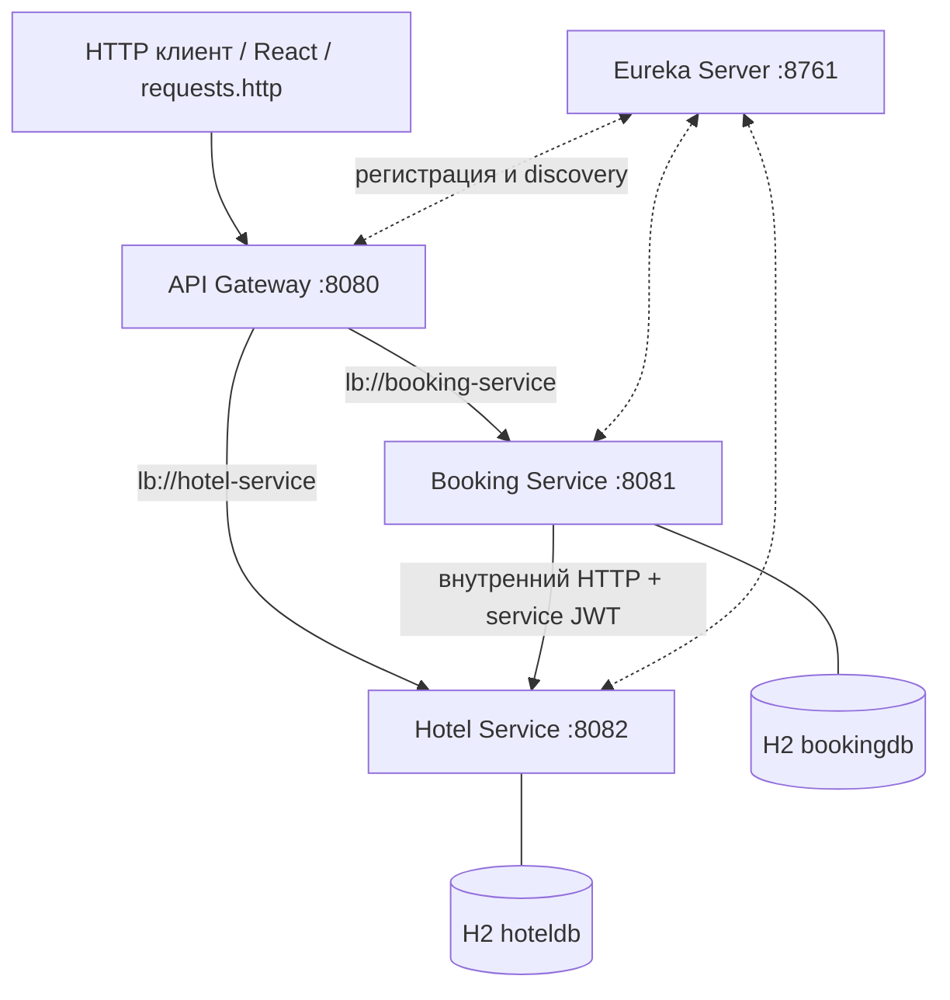
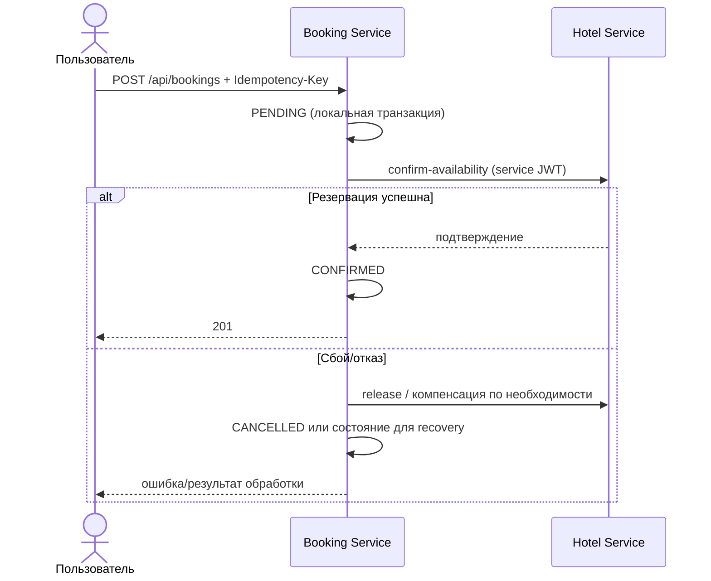

# Hotel Booking System

REST API системы бронирования отелей на Java 17, Spring Boot 4.1.1 и Spring Cloud с микросервисной архитектурой. Учебный проект по заданию Skillfactory / МИФИ: управление гостиницами и номерами, учёт занятости, пользователи и JWT, бронирования с согласованием между сервисами.

> **Область поставки:** этот репозиторий содержит backend из четырёх Spring Boot приложений. React-фронтенд разрабатывается отдельно и не обязателен для запуска API. Приведённые сведения сверены с исходниками версии 31.10.2026; локальные секреты не включаются в документацию. Swagger/OpenAPI присутствует в зависимостях двух бизнес-сервисов, но его финальная настройка/проверка вынесена в отдельную задачу.

## Возможности

- Регистрация и вход, JWT с временем жизни 1 час; роли `USER`, `ADMIN`, отдельная служебная авторизация между микросервисами.
- CRUD отелей, номеров и пользователей; фотографии, удобства, фильтры, пагинация, статистика.
- Ручной выбор номера или автоматический подбор, в том числе `LEAST_BOOKED` и `MOST_EXPENSIVE`.
- Идемпотентное создание бронирований с `Idempotency-Key`, контроль конфликтов дат и защита от конкурентного бронирования.
- Saga: подтверждение бронирования между Booking Service и Hotel Service, компенсация при сбоях, автоматическое и административное восстановление.
- Корреляция `traceId`, обработка ошибок, Retry/Timeout/Circuit Breaker, unit/integration/E2E и нагрузочные сценарии.

## Технологии

| Область | Реализация |
|---|---|
| Язык и сборка | Java 17; Gradle Kotlin DSL / Wrapper |
| Backend | Spring Boot 4.1.1; Spring Cloud 2025.1.3 |
| REST и API | Spring Web MVC; Spring Cloud Gateway WebFlux; springdoc-openapi 3.1.1 (зависимость) |
| Обнаружение | Spring Cloud Netflix Eureka |
| Данные | Spring Data JPA / Hibernate; независимые H2 in-memory; локальные `@Transactional` |
| Безопасность | Spring Security Resource Server, JWT, `@PreAuthorize` |
| Надёжность | Spring Retry (`@Retryable`), Resilience4j Circuit Breaker |
| Проверка | JUnit, Spring Test, MockMvc и E2E |

## Архитектура



| Модуль | Ответственность | Порт |
|---|---|---:|
| `discovery-server` | Реестр Eureka | 8761 |
| `api-gateway` | Внешняя маршрутизация, фильтры безопасности, корреляция | 8080 |
| `booking-service` | Пользователи, JWT, брони, Saga и восстановление | 8081 |
| `hotel-service` | Отели, номера, фотографии, резервации, статистика, подбор | 8082 |

Оба бизнес-сервиса используют **собственные** in-memory БД. Запросы клиентов направляются через Gateway (`/api/users/**`, `/api/bookings/**`, `/api/hotels/**`, `/api/rooms/**`). Защищённые внутренние операции `confirm-availability`/`release` не предназначены для внешнего использования и блокируются политикой Gateway. Подробности: [модули](docs/modules.md), [ADR-001](docs/adr/001-microservices.md), [ADR-002](docs/adr/002-security.md).

## Требования к окружению

- JDK 17 или совместимый JDK; установленный Java в `PATH`/`JAVA_HOME`.
- Свободные порты `8761`, `8080`, `8081`, `8082`.
- Интернет при **первом** запуске Gradle Wrapper для загрузки дистрибутива Gradle и зависимостей (после заполнения кеша Gradle возможна офлайн-сборка).
- **Docker и PostgreSQL не требуются** для этого варианта проекта.

## Настройка секретов

Для Booking Service обязательны переменные окружения:

| Имя | Назначение |
|---|---|
| `JWT_KEYSTORE_PATH` | Путь к PKCS#12 keystore пользовательского JWT |
| `JWT_KEYSTORE_PASSWORD` | Пароль хранилища |
| `SERVICE_JWT_KEYSTORE_PATH` | Путь к отдельному PKCS#12 keystore для service JWT |
| `SERVICE_JWT_KEYSTORE_PASSWORD` | Пароль служебного хранилища |
| `GATEWAY_INTERNAL_SECRET` | Секрет доверенного взаимодействия Gateway/сервисов; согласовать значение между компонентами, которые его используют |
| `ADMIN_EMAIL`, `ADMIN_PASSWORD` | Необязательная инициализация администратора |
| `DEMO_USER_1_PASSWORD`, `DEMO_USER_2_PASSWORD` | Необязательные пароли демопользователей |
| `HOTEL_PHOTOS_DIR` | Необязательный каталог фото, по умолчанию `storage/hotels` |

**Не публикуйте** keystore, пароли, `.properties` с тестовыми учетными данными и локальные secrets в Git. Создать keystore можно утилитой JDK `keytool` (пример для тестовой среды):

```powershell
keytool -genkeypair -alias jwt-signing -keyalg RSA -keysize 3072 -sigalg SHA256withRSA -storetype PKCS12 -keystore user-jwt.p12 -validity 365 -dname "CN=hotel-booking-user"
keytool -genkeypair -alias service-jwt-signing -keyalg RSA -keysize 3072 -sigalg SHA256withRSA -storetype PKCS12 -keystore service-jwt.p12 -validity 365 -dname "CN=hotel-booking-service"
```

`keytool` предложит пароль; затем укажите пути и пароли в переменных окружения **каждой соответствующей Run Configuration**, а `GATEWAY_INTERNAL_SECRET` — в конфигурациях Gateway и Booking/Hotel там, где он читается. Не помещайте секреты в общий коммитимый `application.yml`. Если запускаете из одной консоли, задайте переменные там перед стартом сервисов. За деталями назначения заголовков обратитесь к конфигурациям безопасности.

## Сборка и запуск

Из корня репозитория:

```powershell
# Windows PowerShell
.\gradlew.bat clean test
```

```bash
# macOS / Linux
chmod +x ./gradlew
./gradlew clean test
```

В отдельных терминалах/Run Configurations запускайте в порядке:

```powershell
.\gradlew.bat :discovery-server:bootRun
.\gradlew.bat :api-gateway:bootRun
.\gradlew.bat :hotel-service:bootRun
.\gradlew.bat :booking-service:bootRun
```

На macOS/Linux замените ` .\gradlew.bat` на `./gradlew`. Дождитесь регистрации Gateway, Booking и Hotel в Eureka: `http://localhost:8761/`. При холодном старте discovery короткие `503` возможны до регистрации сервисов. HTTP-запросы для ручной проверки находятся в `requests.http` и вспомогательных `.http` файлах репозитория.

## Использование API

Базовый адрес: `http://localhost:8080`. Самые важные маршруты:

| HTTP | Маршрут | Назначение |
|---|---|---|
| POST | `/api/users/register` | Регистрация |
| POST | `/api/users/login` | Получение JWT |
| GET | `/api/users/me` | Профиль |
| GET | `/api/hotels` | Список отелей |
| GET | `/api/rooms?hotelId=1` | Номера отеля с фильтрами/пагинацией |
| GET | `/api/rooms/recommend?hotelId=1&checkIn=2026-11-15&checkOut=2026-11-18` | Рекомендации |
| POST | `/api/bookings` | Бронирование (JWT + `Idempotency-Key: <UUID>`) |
| GET | `/api/bookings/my` | Личная история |
| GET | `/api/bookings/{id}` | Получение брони |
| PATCH | `/api/bookings/{id}/cancel` | Отмена брони |
| GET | `/api/hotels/{hotelId}/statistics` | Статистика |

Зарегистрируйте пользователя, затем выполните вход и используйте `Authorization: Bearer <JWT>` для защищённых запросов. Пример тела `POST /api/bookings` для **ручного** выбора:

```json
{
  "roomId": 1,
  "autoSelect": false,
  "checkIn": "2026-11-15",
  "checkOut": "2026-11-18",
  "guestCount": 2
}
```

При `autoSelect: true` укажите `hotelId` вместо `roomId`; доступны параметры стратегии, если они поддерживаются выбранным сценарием. Для даты используйте будущие значения относительно момента тестирования. Полный перечень контроллерных маршрутов и их ограничений см. [API](docs/api.md).

## Бронирование и согласованность



Идемпотентный ключ запрещает создавать повторную бронь из повторной доставки одного и того же запроса. Hotel Service проверяет занятость **по интервалам дат**, а `available` служит операционным признаком номера (например, вывод из эксплуатации). Для действующих подтверждённых броней `timesBooked` увеличивается; при корректной отмене уменьшается без повторного списания. См. [ADR-003](docs/adr/003-distributed-booking.md), [ADR-004](docs/adr/004-room-selection.md), [ADR-006](docs/adr/006-saga-recovery.md).

## Тестирование

1. `clean test`: unit/integration Spring-тесты из модулей.
2. E2E запускаются отдельно, при работающих четырёх сервисах и корректно заданных тестовых секретах/данных; не считать их частью обычного `test` без проверки текущей конфигурации Gradle.
3. Для устойчивой повторяемости E2E полезен **чистый рестарт сервисов**, так как H2 in-memory хранит данные только пока жив процесс.
4. Отдельно проверить регистрацию, 401/403, конфликт 409, параллельные бронирования, сбои Hotel Service, retry/compensation/recovery, счетчик `timesBooked`.

Подробности: [тестирование](docs/testing.md). Из ранее подтверждённых результатов: unit-тесты прошли после рефакторинга фотосервисов и поиска номеров; E2E после этого изменения отдельно не подтверждались.

## Документация

- [Описание модулей](docs/modules.md)
- [REST API](docs/api.md)
- [Модель данных](docs/database.md)
- [Тестирование и демонстрация](docs/testing.md)
- [Реестр ADR](docs/adr/README.md) — 6 архитектурных решений

## Ограничения и статус

- `H2 in-memory` и `ddl-auto: create-drop`: после рестарта содержимое БД теряется; это требование учебной версии.
- Фотографии хранятся в локальной файловой системе; для многорепликового production-развёртывания нужна внешняя общая система хранения.
- Локальные in-memory механизмы ограничения частоты запросов не являются распределённым лимитером на несколько экземпляров.
- Прямой доступ к портам бизнес-сервисов допустим для локальной отладки, но для production требуется сетевая изоляция и политика доступа.
- Swagger/OpenAPI **включён как зависимость** в Booking и Hotel; до завершения проверки UI/защиты/аннотаций не заявляется как законченная демонстрационная функция.
