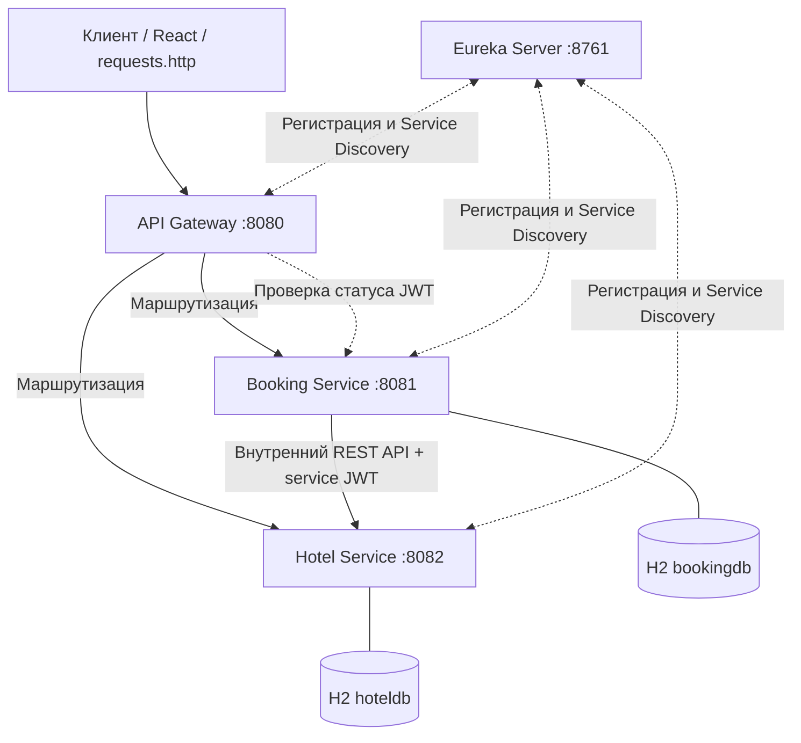
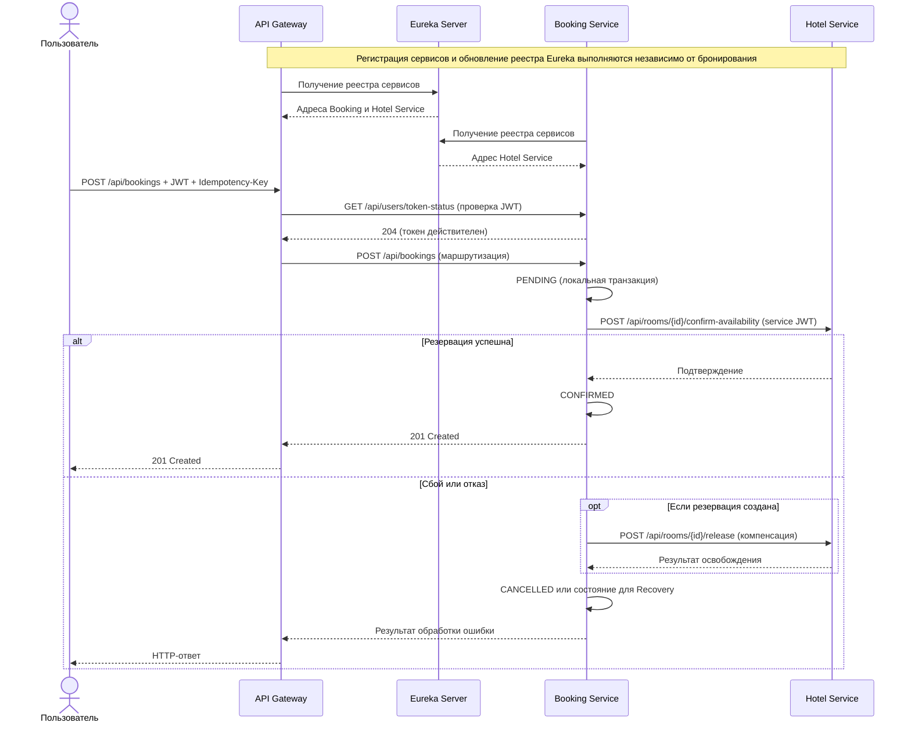

# Hotel Booking System

REST API системы бронирования отелей на Java 17, Spring Boot 4.1.1 и Spring Cloud с микросервисной архитектурой. Учебный проект по заданию Skillfactory / МИФИ: управление гостиницами и номерами, учёт занятости, пользователи и JWT, бронирования с согласованием между сервисами.

## Возможности

- Регистрация и вход, JWT с временем жизни 1 час; роли `USER`, `ADMIN`, отдельная служебная авторизация между микросервисами.
- CRUD отелей, номеров и пользователей; фотографии, удобства, фильтры, пагинация, статистика.
- Ручной выбор номера или автоматический подбор, в том числе `LEAST_BOOKED` и `MOST_EXPENSIVE`.
- Идемпотентное создание бронирований с `Idempotency-Key`, контроль конфликтов дат и защита от конкурентного бронирования.
- Saga: подтверждение бронирования между Booking Service и Hotel Service, компенсация при сбоях, автоматическое и административное восстановление.
- Корреляция `traceId`, обработка ошибок, Retry/Timeout/Circuit Breaker, unit/integration/E2E и нагрузочные сценарии.

## Технологии

| Область | Реализация |
|---|---|
| Язык и сборка | Java 17; Gradle Kotlin DSL / Wrapper |
| Backend | Spring Boot 4.1.1; Spring Cloud 2025.1.3 |
| REST и API | Spring Web MVC; Spring Cloud Gateway WebFlux; springdoc-openapi 3.1.1, Swagger UI |
| Обнаружение | Spring Cloud Netflix Eureka |
| Данные | Spring Data JPA / Hibernate; независимые H2 in-memory; локальные `@Transactional` |
| Безопасность | Spring Security Resource Server, JWT, `@PreAuthorize` |
| Надёжность | Spring Retry (`@Retryable`), Resilience4j Circuit Breaker |
| Проверка | JUnit, Spring Test, MockMvc и E2E |

## Архитектура



| Модуль | Ответственность | Порт |
|---|---|---:|
| `discovery-server` | Реестр Eureka | 8761 |
| `api-gateway` | Внешняя маршрутизация, фильтры безопасности, корреляция | 8080 |
| `booking-service` | Пользователи, JWT, брони, Saga и восстановление | 8081 |
| `hotel-service` | Отели, номера, фотографии, резервации, статистика, подбор | 8082 |

Оба бизнес-сервиса используют **собственные** in-memory БД. Запросы клиентов направляются через Gateway (`/api/users/**`, `/api/bookings/**`, `/api/hotels/**`, `/api/rooms/**`). Защищённые внутренние операции `confirm-availability`/`release` не предназначены для внешнего использования и блокируются политикой Gateway. Подробности: [модули](docs/modules.md), [ADR-001](docs/adr/001-microservices.md), [ADR-002](docs/adr/002-security.md).

## Требования к окружению

- JDK 17 или совместимый JDK; установленный Java в `PATH`/`JAVA_HOME`.
- Свободные порты `8761`, `8080`, `8081`, `8082`.
- Интернет при **первом** запуске Gradle Wrapper для загрузки дистрибутива Gradle и зависимостей (после заполнения кеша Gradle возможна офлайн-сборка).
- **Docker и PostgreSQL не требуются** для этого варианта проекта.

## Настройка секретов

Для Booking Service обязательны переменные окружения:

| Имя | Назначение |
|---|---|
| `JWT_KEYSTORE_PATH` | Путь к PKCS#12 keystore пользовательского JWT |
| `JWT_KEYSTORE_PASSWORD` | Пароль хранилища |
| `SERVICE_JWT_KEYSTORE_PATH` | Путь к отдельному PKCS#12 keystore для service JWT |
| `SERVICE_JWT_KEYSTORE_PASSWORD` | Пароль служебного хранилища |
| `GATEWAY_INTERNAL_SECRET` | Секрет доверенного взаимодействия Gateway/сервисов; согласовать значение между компонентами, которые его используют |
| `ADMIN_EMAIL`, `ADMIN_PASSWORD` | Необязательная инициализация администратора |
| `DEMO_USER_1_PASSWORD`, `DEMO_USER_2_PASSWORD` | Необязательные пароли демопользователей |
| `HOTEL_PHOTOS_DIR` | Необязательный каталог фото, по умолчанию `storage/hotels` |

Создать keystore можно утилитой JDK `keytool` (пример для тестовой среды):

```powershell
keytool -genkeypair -alias jwt-signing -keyalg RSA -keysize 3072 -sigalg SHA256withRSA -storetype PKCS12 -keystore user-jwt.p12 -validity 365 -dname "CN=hotel-booking-user"
keytool -genkeypair -alias service-jwt-signing -keyalg RSA -keysize 3072 -sigalg SHA256withRSA -storetype PKCS12 -keystore service-jwt.p12 -validity 365 -dname "CN=hotel-booking-service"
```

`keytool` предложит пароль; затем укажите пути и пароли в переменных окружения **каждой соответствующей Run Configuration**, а `GATEWAY_INTERNAL_SECRET` — в конфигурациях Gateway и Booking/Hotel там, где он читается. Перед запуском сервисов настройте необходимые переменные окружения в Run Configurations IntelliJ IDEA. При запуске из терминала переменные должны быть заданы в окружении процесса, из которого запускается соответствующий сервис. 
API Gateway проверяет JWT и добавляет служебный заголовок X-Gateway-Internal-Secret, который используется backend-сервисами для защиты от прямого обращения. Gateway также передаёт проверенный IP клиента через X-Verified-Client-IP. Значения служебных секретов задаются через переменные окружения и не должны передаваться пользователями вручную

## Конфигурации запуска в IntelliJ IDEA

В меню **Run → Edit Configurations** создайте четыре конфигурации типа **Spring Boot** (кнопка **+**). Выберите **JDK 17**, модуль и главный класс из таблицы. Для Booking и Hotel укажите `-Dspring.profiles.active=dev` в поле **VM options** (если поле скрыто — **Modify options → Add VM options**).

| Конфигурация | Module (Use classpath of module) | Main class | VM options |
|---|---|---|---|
| `DiscoveryServerApplication` | `hotel-booking-system.discovery-server.main` | `com.hotelbooking.discovery.DiscoveryServerApplication` | — |
| `GatewayApplication` | `hotel-booking-system.api-gateway.main` | `com.hotelbooking.gateway.GatewayApplication` | — |
| `HotelServiceApplication` | `hotel-booking-system.hotel-service.main` | `com.hotelbooking.hotel.HotelServiceApplication` | `-Dspring.profiles.active=dev` |
| `BookingServiceApplication` | `hotel-booking-system.booking-service.main` | `com.hotelbooking.booking.BookingServiceApplication` | `-Dspring.profiles.active=dev` |

В поле **Environment variables** настройте:

| Конфигурация | Переменные окружения |
|---|---|
| Discovery Server | Не требуются |
| API Gateway | `GATEWAY_INTERNAL_SECRET` |
| Hotel Service | `GATEWAY_INTERNAL_SECRET`, `APP_DEMO_ENABLED=true`, `HOTEL_PHOTOS_DIR=$PROJECT_DIR$/storage/hotels` |
| Booking Service | `GATEWAY_INTERNAL_SECRET`, `JWT_KEYSTORE_PATH`, `JWT_KEYSTORE_PASSWORD`, `SERVICE_JWT_KEYSTORE_PATH`, `SERVICE_JWT_KEYSTORE_PASSWORD`, `APP_DEMO_ENABLED=true`, `ADMIN_EMAIL`, `ADMIN_PASSWORD`, `DEMO_USER_1_PASSWORD`, `DEMO_USER_2_PASSWORD` |

`GATEWAY_INTERNAL_SECRET` должен иметь **одно и то же значение** в Gateway, Hotel и Booking. Пути `JWT_KEYSTORE_PATH` и `SERVICE_JWT_KEYSTORE_PATH` должны указывать на PKCS#12-файлы, соответствующие сертификатам проверки JWT в Gateway и Hotel Service. Пароли и сами секреты в README не приводятся. После настройки запускайте сервисы в порядке Eureka → Gateway → Hotel → Booking.

**E2E All:** отдельная конфигурация **JUnit** для модуля `hotel-booking-system.booking-service.test`, с **JDK 17**, выбором **All in package** → `com.hotelbooking.booking.e2e`, **VM options** `-ea -Dhotel.e2e=true` и **Working directory** `$MODULE_WORKING_DIR$`. Четыре сервиса должны быть запущены. Подробности, в том числе сценарии Saga Fault и файл локальных ADMIN-параметров, приведены в [документации тестирования](docs/testing.md).

## Сборка и запуск

Из корня репозитория:

```powershell
# Windows PowerShell
.\gradlew.bat clean test
```

```bash
# macOS / Linux
chmod +x ./gradlew
./gradlew clean test
```

В отдельных терминалах/Run Configurations запускайте в порядке:

```powershell
.\gradlew.bat :discovery-server:bootRun
.\gradlew.bat :api-gateway:bootRun
.\gradlew.bat :hotel-service:bootRun
.\gradlew.bat :booking-service:bootRun
```

На macOS/Linux используйте `./gradlew` вместо ` .\gradlew.bat`. Дождитесь регистрации Gateway, Booking и Hotel в Eureka: `http://localhost:8761/`. При холодном старте discovery короткие `503` возможны до регистрации сервисов. HTTP-запросы для ручной проверки находятся в `requests.http` и вспомогательных `.http` файлах репозитория.

## Использование API

Базовый адрес: `http://localhost:8080`. Самые важные маршруты:

| HTTP | Маршрут | Назначение |
|---|---|---|
| POST | `/api/users/register` | Регистрация |
| POST | `/api/users/login` | Получение JWT |
| GET | `/api/users/me` | Профиль |
| GET | `/api/hotels` | Список отелей |
| GET | `/api/rooms?hotelId=1` | Номера отеля с фильтрами/пагинацией |
| GET | `/api/rooms/recommend?hotelId=1&checkIn=2026-11-15&checkOut=2026-11-18` | Рекомендации |
| POST | `/api/bookings` | Бронирование (JWT + `Idempotency-Key: <UUID>`) |
| GET | `/api/bookings/my` | Личная история |
| GET | `/api/bookings/{id}` | Получение брони |
| PATCH | `/api/bookings/{id}/cancel` | Отмена брони |
| GET | `/api/hotels/{hotelId}/statistics` | Статистика |

Зарегистрируйте пользователя, затем выполните вход и используйте `Authorization: Bearer <JWT>` для защищённых запросов. Пример тела `POST /api/bookings` для **ручного** выбора:

```json
{
  "roomId": 1,
  "autoSelect": false,
  "checkIn": "2026-11-15",
  "checkOut": "2026-11-18",
  "guestCount": 2
}
```

При `autoSelect: true` укажите `hotelId` вместо `roomId`; стратегия выбора устанавливается в настройках отеля. Для даты используйте будущие значения относительно текущей даты. Полный перечень маршрутов и их ограничений см. [API](docs/api.md).

## Swagger / OpenAPI

В Booking Service и Hotel Service подключён springdoc-openapi. Документация формируется по REST-контроллерам и DTO. Для защищённых запросов предусмотрена схема HTTP Bearer JWT.

| Сервис | Swagger UI | OpenAPI JSON |
|---|---|---|
| Booking Service | `http://localhost:8081/swagger-ui.html` | `http://localhost:8081/v3/api-docs` |
| Hotel Service | `http://localhost:8082/swagger-ui.html` | `http://localhost:8082/v3/api-docs` |

Откройте Swagger UI, нажмите **Authorize** и вставьте JWT, полученный через `/api/users/login`. Регистрация и вход доступны без JWT. Служебные операции бронирования номеров исключены из публичной спецификации Hotel Service через `@Hidden`. Страницы Swagger открываются напрямую на портах соответствующих сервисов; защищённые REST-операции продолжают проверять авторизацию.

## Бронирование и согласованность



Идемпотентный ключ запрещает создавать повторную бронь из повторной доставки одного и того же запроса. Hotel Service проверяет занятость **по интервалам дат**, а `available` служит операционным признаком номера (например, вывод из эксплуатации). Для действующих подтверждённых броней `timesBooked` увеличивается; при корректной отмене уменьшается без повторного списания. См. [ADR-003](docs/adr/003-distributed-booking.md), [ADR-004](docs/adr/004-room-selection.md), [ADR-006](docs/adr/006-saga-recovery.md).

## Тестирование

Проект включает модульные (Unit), интеграционные (Integration) и сквозные (E2E) тесты.

**Модульные и интеграционные тесты** запускаются из корня проекта командой:

```powershell
.\gradlew.bat clean test
```

**E2E-тестирование** выполняется через конфигурацию `E2E All` в IntelliJ IDEA при работающих Eureka Server, API Gateway, Hotel Service и Booking Service. Для изоляции повторных прогонов используется перезапуск сервисов со сбросом данных H2 in-memory.

Автоматизированные тесты охватывают:

- Регистрацию, аутентификацию и разграничение прав доступа (401/403).
- Проверку конфликтов бронирования (409), параллельных запросов и идемпотентности.
- Работу алгоритмов подбора номеров.
- Сбои Hotel Service, Retry, Timeout и Circuit Breaker.
- Подтверждение, компенсацию и восстановление Saga (Recovery).
- Корректность учёта бронирований в `timesBooked`.

Все Unit- и E2E-тесты успешно прошли на актуальной версии проекта.

Подробности: [тестирование](docs/testing.md). 

## Документация

- [Описание модулей](docs/modules.md)
- [REST API](docs/api.md)
- [Модель данных](docs/database.md)
- [Тестирование и демонстрация](docs/testing.md)
- [Реестр ADR](docs/adr/README.md) — 7 архитектурных решений

## Ограничения и статус

- `H2 in-memory` и `ddl-auto: create-drop`: после рестарта содержимое БД теряется; это требование учебной версии.
- Фотографии хранятся в локальной файловой системе. См. [ADR-007](docs/adr/007-photo-storage.md).
- Локальные in-memory механизмы ограничения частоты запросов не являются распределённым лимитером на несколько экземпляров.

