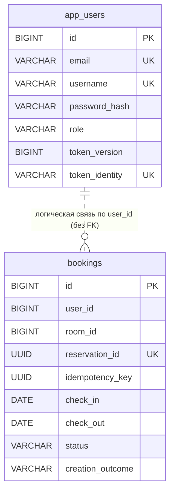
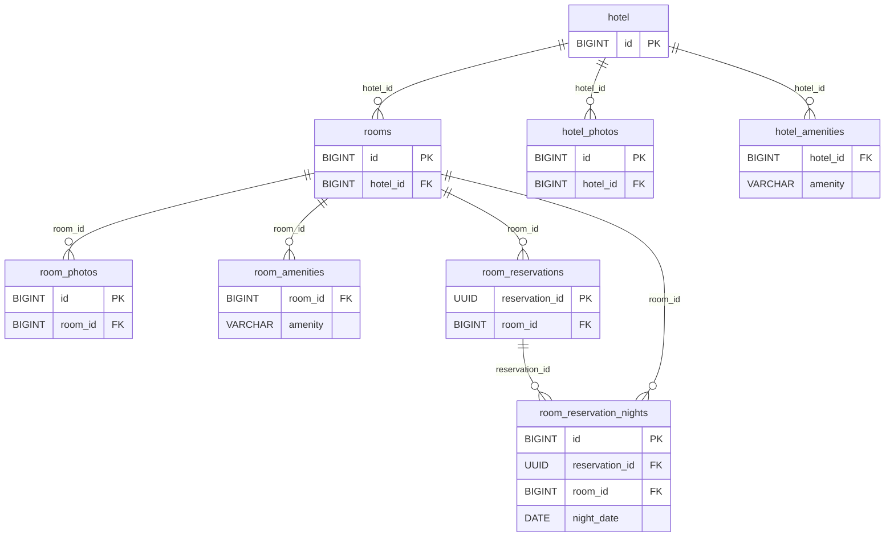

# Модель данных и структура баз данных

> Источник: JPA-сущности и конфигурации `booking-service` и `hotel-service` из `hotel-booking-system(20261031-181738).zip` (31.10.2026). Это описание **фактической модели исходного кода**, а не выгрузка схемы из работающего экземпляра H2. Имена и явные ограничения взяты из `@Table`, `@Column`, `@JoinColumn`, `@CollectionTable`; для полей без заданного SQL-имени указано имя по стандартному Hibernate/Spring naming. Физические SQL-типы могут уточняться выбранным диалектом Hibernate.

## 1. Общая архитектура хранения

| Модуль | Хранилище | URL подключения | Создание схемы | Собственные таблицы |
|---|---|---|---|---|
| `booking-service` | H2 in-memory | `jdbc:h2:mem:bookingdb` | `spring.jpa.hibernate.ddl-auto=create-drop` | `app_users`, `bookings` |
| `hotel-service` | H2 in-memory | `jdbc:h2:mem:hoteldb` | `spring.jpa.hibernate.ddl-auto=create-drop` | `hotel`, `hotel_amenities`, `hotel_photos`, `rooms`, `room_amenities`, `room_photos`, `room_reservations`, `room_reservation_nights` |
| `api-gateway` | Не используется | — | — | Нет |
| `discovery-server` (Eureka) | Не используется | — | — | Нет |

Схемы независимы: **между базами нет SQL foreign key**. Связь `Booking.roomId` с `Hotel Service / rooms.id` существует только на уровне сервисного взаимодействия, а `Booking.userId` — простое числовое поле внутри Booking Service (без JPA-связи). При остановке приложения данные его H2 in-memory теряются; при старте Hibernate создаёт таблицы заново, а демо-инициализаторы могут заполнить стартовые записи. PostgreSQL и общая БД в данном исходном архиве не настроены.

### Обозначения

- **PK** — первичный ключ, **FK** — внешний ключ, **UK** — уникальное ограничение, **IDX** — индекс.
- **NN** — `nullable=false` в JPA или обязательность по идентификатору/связи; **NULL** — nullable.
- `Long`, `Integer`, `UUID`, `LocalDate`, `LocalTime`, `Instant`, `BigDecimal` — Java/JPA-типы (не обещание конкретного H2 DDL-типа).
- Поля с `@Enumerated(STRING)` сохраняют текстовые имена значений enum, не ordinal.
- Идентификаторы `IDENTITY` генерируются СУБД. `version` — поле оптимистической блокировки `@Version`.

## 2. Booking Service — `bookingdb`

### 2.1. `app_users` — пользователи и управление доступом

Сущность `com.hotelbooking.booking.entity.AppUser` (`@Table(name="app_users")`).

| Поле | Java/JPA-тип | Ограничения | Назначение |
|---|---|---|---|
| `id` | `Long` | PK, IDENTITY | Идентификатор пользователя |
| `email` | `String(255)` | NN, UK | Email (уникальный) |
| `username` | `String(30)` | NN, UK | Логин (уникальный) |
| `phone` | `String(16)` | NULL | Телефон |
| `first_name` | `String(80)` | NN | Имя |
| `last_name` | `String(80)` | NN | Фамилия |
| `password_hash` | `String` | NN | Хеш пароля, **не открытый пароль** |
| `role` | `Role` → String(20) | NN | `USER` / `ADMIN` |
| `password_change_required` | `boolean` | NN | Обязательная смена пароля; начальное значение `false` |
| `version` | `long` | NN, `@Version` | Защита от потери параллельных изменений |
| `token_version` | `long` | NN | Версия JWT-полномочий; меняется при сбросе пароля или роли |
| `token_identity` | `String(36)` | NN, UK, immutable | UUID-идентичность для проверки/отзыва JWT |

Операции смены роли, обязательной смены пароля и завершения смены пароля увеличивают `token_version`, чтобы старые токены не оставались действительными.

### 2.2. `bookings` — бронирования и состояние Saga

Сущность `com.hotelbooking.booking.entity.Booking` (`@Table(name="bookings")`).

| Поле | Java/JPA-тип | Ограничения | Назначение |
|---|---|---|---|
| `id` | `Long` | PK, IDENTITY | Идентификатор бронирования |
| `user_id` | `Long` | NN, часть UK | ID пользователя; **нет JPA FK** |
| `room_id` | `Long` | NN, часть IDX | ID номера из Hotel Service; **нет межсервисного FK** |
| `check_in` | `LocalDate` | NN, часть IDX | День заселения |
| `check_out` | `LocalDate` | NN, часть IDX | День выезда (не включается в резервируемые ночи) |
| `status` | `BookingStatus` → String | NN | `PENDING`, `CONFIRMED`, `CANCELLING`, `CANCELLED` |
| `idempotency_key` | `UUID` | NULL, часть UK | Идемпотентность создания в рамках пользователя |
| `request_fingerprint` | `String(128)` | NN | Отпечаток полезной нагрузки запроса |
| `version` | `Long` | `@Version` | Оптимистическая блокировка |
| `created_at` | `Instant` | NN, immutable | Время создания |
| `saga_updated_at` | `Instant` | NN, часть IDX | Последнее изменение состояния Saga |
| `recovery_attempts` | `int` | NN | Число попыток восстановления |
| `next_recovery_at` | `Instant` | NN | Время следующей попытки восстановления |
| `cancellation_requested_at` | `Instant` | NULL | Время запроса отмены |
| `reservation_id` | `UUID` | NN, UK, immutable | Сквозной UUID резерва для обмена с Hotel Service |
| `guest_count` | `int` | NN | Число гостей (начальное значение 1) |
| `creation_outcome` | `BookingCreationOutcome` → String | NN, часть IDX | Исход создания / восстановления Saga |

**Перечисление `BookingCreationOutcome`:** `PROCESSING`, `SUCCESS`, `ROOM_CONFLICT`, `FAILED`, `NO_AVAILABLE_ROOMS`, `RECOVERING`, `ROOM_UNAVAILABLE`. Не путать с публичным `BookingStatus`.

**Явные ограничения и индексы `bookings`:**

| Имя | Вид | Столбцы | Назначение |
|---|---|---|---|
| `uk_booking_user_idempotency` | UK | `user_id`, `idempotency_key` | Один ключ для одного пользователя |
| UK по `reservation_id` | UK (`@Column(unique=true)`) | `reservation_id` | Одна запись на один сквозной ID |
| `idx_booking_room_dates` | IDX | `room_id`, `check_in`, `check_out` | Поиск по номеру и интервалу |
| `idx_booking_saga_recovery` | IDX | `status`, `creation_outcome`, `saga_updated_at` | Выборка Saga для восстановления |

Точный сгенерированный SQL-идентификатор уникального индекса `reservation_id` зависит от Hibernate.

## 3. Hotel Service — `hoteldb`

### 3.1. `hotel` — отели

Сущность `com.hotelbooking.hotel.entity.Hotel`. В `@Table` не задано `name`, поэтому ожидаемое имя таблицы при текущем naming strategy — `hotel`.

| Поле | Java/JPA-тип | Ограничения | Назначение |
|---|---|---|---|
| `id` | `Long` | PK, IDENTITY | ID отеля |
| `version` | `Long` | NN, `@Version` | Оптимистическая блокировка |
| `name` | `String(150)` | NN, часть 2 UK | Название |
| `address` | `String` | NN, часть UK | Адрес |
| `normalized_name` | `String(150)` | NN, часть UK | Нормализованное (trim/lowercase) название |
| `normalized_address` | `String(255)` | NN, часть UK | Нормализованный адрес |
| `description` | `String(3000)` | NULL | Описание отеля |
| `rating` | `BigDecimal(2,1)` | NULL | Рейтинг |
| `check_in_time` | `LocalTime` | NN | Время заселения; по умолчанию 14:00 |
| `check_out_time` | `LocalTime` | NN | Время выезда; по умолчанию 12:00 |
| `room_selection_strategy` | `RoomSelectionMode` → String(32) | NN | Стратегия выбора номера; по умолчанию `LEAST_BOOKED` |

**Явные UK:** `uk_hotel_name_address (name,address)` и `uk_hotel_normalized_name_address (normalized_name,normalized_address)`. Нормализованные значения пересчитываются при `@PrePersist/@PreUpdate`; это защита от дублей в другом регистре.

### 3.2. `hotel_amenities` — удобства отелей

`@ElementCollection` поля `Hotel.amenities`; отдельной Java-сущности нет.

| Поле | Java/JPA-тип | Ограничения | Назначение |
|---|---|---|---|
| `hotel_id` | `Long` | FK → `hotel.id` | Отель |
| `amenity` | `HotelAmenity` → String(40) | NN | `WIFI`, `PARKING`, `POOL`, `GYM`, `RESTAURANT` |

Hibernate управляет строками этой таблицы через набор `Set<HotelAmenity>`. В коде **не объявлено отдельное именованное UK** для `(hotel_id,amenity)`; не следует подменять это предположением о физическом DDL.

### 3.3. `hotel_photos` — фотографии отелей

Сущность `HotelPhoto`. Хранятся **метаданные**, а бинарные фотографии — в файловом каталоге (см. `app.photos.directory` и ADR о фото).

| Поле | Java/JPA-тип | Ограничения | Назначение |
|---|---|---|---|
| `id` | `Long` | PK, IDENTITY | ID фотографии |
| `hotel_id` | `Long` | NN, FK → `hotel.id`, часть IDX | Владелец |
| `file_name` | `String(64)` | NN | Имя файла в хранилище |
| `content_type` | `String(30)` | NN | MIME-тип |
| `is_primary` | `boolean` | NN | Основное фото |
| `sort_order` | `int` | NN, часть IDX | Порядок отображения |

Индекс: `idx_photo_hotel_order (hotel_id,sort_order)`.

### 3.4. `rooms` — номера

Сущность `Room`.

| Поле | Java/JPA-тип | Ограничения | Назначение |
|---|---|---|---|
| `id` | `Long` | PK, IDENTITY | ID номера |
| `hotel_id` | `Long` | NN, FK → `hotel.id`, часть UK | Отель |
| `number` | `String(20)` | NN, часть UK | Номер комнаты в отеле |
| `demo_seed_key` | `String(100)` | NULL, UK | Неизменяемый ключ автоматически созданной демо-комнаты; у обычной записи NULL |
| `available` | `boolean` | NN | Операционная доступность/доступность к продаже; не означает отсутствие занятых дат |
| `times_booked` | `long` | NN | Счётчик действующих подтверждённых броней |
| `category` | `RoomCategory` → String(20) | NN | `STANDARD`, `DELUXE`, `SUITE` |
| `capacity` | `int` | NN | Вместимость; начальное значение 2 |
| `price_per_night` | `BigDecimal(12,2)` | NN | Цена за ночь; начальное значение 0 |

UK: `uk_rooms_hotel_number (hotel_id,number)`; UK `demo_seed_key` задаётся `@Column(unique=true)`.

### 3.5. `room_amenities` — удобства номеров

`@ElementCollection` поля `Room.amenities`; не отдельная сущность.

| Поле | Java/JPA-тип | Ограничения | Назначение |
|---|---|---|---|
| `room_id` | `Long` | FK → `rooms.id` | Номер |
| `amenity` | `RoomAmenity` → String(40) | NN | `WIFI`, `TV`, `AIR_CONDITIONING`, `MINIBAR`, `BALCONY` |

Именованный уникальный индекс для пары `room_id,amenity` в JPA-коде не объявлен.

### 3.6. `room_photos` — фотографии номеров

Сущность `RoomPhoto`. Файлы лежат отдельно от H2; таблица хранит метаданные.

| Поле | Java/JPA-тип | Ограничения | Назначение |
|---|---|---|---|
| `id` | `Long` | PK, IDENTITY | ID фотографии |
| `room_id` | `Long` | NN, FK → `rooms.id`, часть IDX | Владелец |
| `file_name` | `String(64)` | NN | Имя файла |
| `content_type` | `String(30)` | NN | MIME-тип |
| `is_primary` | `boolean` | NN | Основное фото |
| `sort_order` | `int` | NN, часть IDX | Порядок отображения |

Индекс: `idx_photo_room_order (room_id,sort_order)`.

### 3.7. `room_reservations` — операции резервирования

Сущность `RoomReservation`. Запись идентифицируется тем же `reservation_id`, который создаётся в Booking Service.

| Поле | Java/JPA-тип | Ограничения | Назначение |
|---|---|---|---|
| `reservation_id` | `UUID` | PK, **без IDENTITY** | Идентификатор распределённой операции |
| `room_id` | `Long` | NN, FK → `rooms.id` | Номер |
| `check_in` | `LocalDate` | NULL | Начало интервала; пусто у release-before-reserve tombstone |
| `check_out` | `LocalDate` | NULL | Конец интервала, не включительно; может отсутствовать у tombstone |
| `guest_count` | `Integer` | NULL | Число гостей; NULL разрешён для tombstone |
| `status` | `ReservationStatus` → String | NN | `RESERVED`, `RELEASED` |
| `tombstone` | `boolean` | NN | Технический маркер release-before-reserve |
| `version` | `Long` | `@Version` | Защита от гонок обновления |

**Tombstone:** если `release` пришёл раньше `reserve` с тем же `reservation_id`, сохраняется `RELEASED` с `tombstone=true`. Это блокирует запоздавший `reserve`, но не считается реальным отменённым бронированием.

### 3.8. `room_reservation_nights` — занятость по ночам

Сущность `RoomReservationNight`; обеспечивает ограничения на пересечения одного номера.

| Поле | Java/JPA-тип | Ограничения | Назначение |
|---|---|---|---|
| `id` | `Long` | PK, IDENTITY | ID строки |
| `reservation_id` | `UUID` | NN, FK → `room_reservations.reservation_id`, часть IDX | Резервирование |
| `room_id` | `Long` | NN, FK → `rooms.id`, часть UK | Номер |
| `night_date` | `LocalDate` | NN, часть UK | Конкретная занятая ночь |

**Явные ограничения:** `uk_room_night (room_id,night_date)` и индекс `idx_reservation_night (reservation_id)`. Одинаковую ночь одного номера не могут занять две успешные резервации даже при конкурентных запросах. Выезд (`check_out`) исключён из интервала; прилегающие бронирования без общей ночи разрешены.

## 4. Связи таблиц

### 4.1. Booking Service



### 4.2. Hotel Service



**Межсервисная корреляция (не SQL-связи):** `bookings.room_id` → `hotel-service.rooms.id`; `bookings.reservation_id` ↔ `hotel-service.room_reservations.reservation_id`. Её согласованность обеспечивается вызовами сервисов и механизмами Saga, а не внешними ключами между H2.

## 5. Бизнес-инварианты хранения

1. **Занятость конкретных дат:** источник истины — `room_reservation_nights`. Отдельный флаг `rooms.available` отвечает за административное разрешение использования номера, а не за все календарные слоты.
2. **Интервал бронирования:** `[check_in, check_out)`; дата выезда не резервируется.
3. **Конкуренция:** UK `uk_room_night` защищает конкретную пару «номер + ночь»; `@Version` применяется в моделях, где объявлен.
4. **Идемпотентность:** `(user_id,idempotency_key)` уникальна для Booking Service; `reservation_id` уникален между операциями и используется для replay/compensation/recovery.
5. **Счётчик `rooms.times_booked`:** после подтверждения +1, после успешной отмены −1 **один раз**; компенсированная неуспешная Saga не должна оставлять прирост. Это прикладное правило, а не SQL `CHECK`.
6. **Восстановление Saga:** `status`, `creation_outcome`, `saga_updated_at`, `recovery_attempts`, `next_recovery_at` описывают обработку незавершённых операций.
7. **Технические tombstone:** `room_reservations.tombstone=true` не отражает реальное проживание и не должен попадать в бизнес-статистику отмен.
8. **Фото:** БД хранит `file_name`, `content_type`, признак основного и порядок; реальные байты располагаются на диске. Откат/удаление должен согласованно обрабатывать файловую часть.
9. **Уникальность отеля:** имя+адрес и нормализованная пара защищены отдельными UK; уникальность номера действует в пределах отеля.
10. **Ограничения уровня сервиса** (например, вместимость, допустимый срок проживания, размер фото) не обязательно являются ограничениями SQL; их нужно отличать от перечисленных JPA-ключей.

## 6. Проверка реальной схемы H2

После запуска сервиса в H2 Console (если включена в используемом профиле) можно сверить созданные Hibernate таблицы и колонки. Подключаться нужно **к базе соответствующего работающего процесса**; две H2 in-memory базы не объединяются автоматически:

```sql
SELECT TABLE_NAME
FROM INFORMATION_SCHEMA.TABLES
WHERE TABLE_SCHEMA = 'PUBLIC'
ORDER BY TABLE_NAME;

SELECT TABLE_NAME, COLUMN_NAME, DATA_TYPE, IS_NULLABLE
FROM INFORMATION_SCHEMA.COLUMNS
WHERE TABLE_SCHEMA = 'PUBLIC'
ORDER BY TABLE_NAME, ORDINAL_POSITION;
```

Источники модели: `booking-service/src/main/java/com/hotelbooking/booking/entity/`, `hotel-service/src/main/java/com/hotelbooking/hotel/entity/`, `*/src/main/resources/application.yml`. Диаграммы иллюстрируют JPA-модель, а не гарантируют идентичный SQL DDL при смене Hibernate/dialect.
